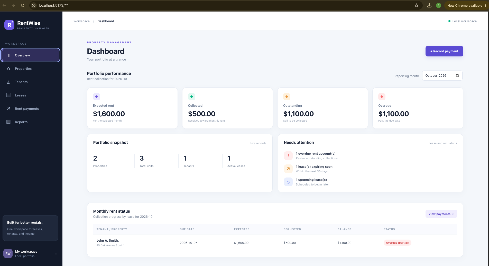

# RentWise — Rental Property Management System

A full-stack web application designed to help landlords manage rental properties, tenants, lease agreements, and monthly rent payments through a centralized dashboard.

## Features
## Application Preview


- **Property Management:** Add, edit, and manage rental properties with multiple units.
- **Tenant Management:** Maintain tenant contact information and rental records.
- **Lease Management:** Create and update lease agreements, prevent overlapping leases for the same unit, and track upcoming lease expirations.
- **Rent Payment Tracking:** Record full and partial payments, monitor outstanding balances, and view payment history.
- **Overdue Rent Alerts:** Automatically identify overdue payments and partially paid rent.
- **Payment Corrections:** Void incorrect payment entries while preserving transaction history.
- **Dashboard:** View expected rent, collected income, outstanding balances, property statistics, and important alerts.
- **Financial Reports:** Review monthly rental performance and payment status by lease.

## Tech Stack

| Layer | Technologies |
|---|---|
| Frontend | React, Vite, JavaScript, CSS |
| Backend | Python, Flask, Flask-CORS |
| Database | SQLite |
| API | RESTful HTTP endpoints |
| Version Control | Git, GitHub |

## Getting Started

### Prerequisites

Install Python 3 and Node.js with npm.

### 1. Clone the repository

```bash
git clone https://github.com/jhaj-47/RentWise.git
cd RentWise
```

### 2. Start the backend

```bash
cd backend
python3 -m venv .venv
source .venv/bin/activate
pip install flask flask-cors
python app.py
```

The Flask API runs at `http://127.0.0.1:5000`.

### 3. Start the frontend

Open a second terminal:

```bash
cd RentWise/frontend
npm install
npm run dev
```

If you are already inside the RentWise project folder, use `cd frontend` instead.

Open `http://localhost:5173` in your browser.

## Project Structure

```text
RentWise/
├── backend/
│   ├── app.py
│   ├── database.py
│   └── test_leases.py
├── frontend/
│   ├── public/
│   ├── src/
│   │   ├── App.jsx
│   │   ├── App.css
│   │   ├── Records.jsx
│   │   ├── Leases.jsx
│   │   ├── Payments.jsx
│   │   └── index.css
│   └── package.json
└── .gitignore
```

## Data Storage

RentWise uses SQLite for persistent storage of properties, tenants, leases, and payment records. The local database file is excluded from GitHub through `.gitignore`.

## Current Status

RentWise is a portfolio project designed for local development and demonstration. It is not currently deployed as a publicly hosted application.

## Future Improvements

- User authentication and account management
- Interactive financial charts
- Exportable reports
- Cloud deployment with persistent database hosting
- Additional automated tests

---

Built with React, Flask, Python, and SQLite.
